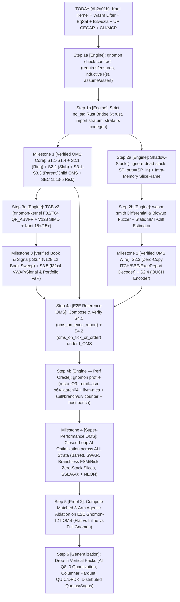

# Project Gnomon Roadmap — E2E Verified OMS Strata Execution Plan

## 1. North Star: Specialize Deeply First (Trading / OMS) → Generalize Cleanly Next

Project Gnomon is a **Verified AI Systems & Performance Engineering Engine** targeting native **x86-64 and ARM64** systems code written in **strict `no_std` Rust** (with `rustc`/LLVM trusted for native lowering, and deterministic `wasm32` / `GnomonIR` serving as the tiny, Kani-verified semantic verification layer).

**Vertical Beachhead:** An **E2E Verified, Ultra-Low-Latency OMS (+ Tick-to-Trade Core) — `Gnomon-T2T`**.
- **Why Trading / OMS first:** Production HFT/OMS cores are already deterministic, single-threaded, zero-allocation (`no_std`) state machines pinned to isolated cores—a 1-to-1 match for Gnomon's semantics—where every 1-in-2³² edge-case bug causes catastrophic loss (over-fills, credit leaks, crossed books, `NaN` quote poisoning) and every nanosecond matters.
- **Correctness Foundation First, Performance Oracle Last:** We build and verify the *complete* 14-Stratum E2E OMS correctness stack first (Steps 1–3: contracts → slices/wire → FP/SIMD), then drop in the native **x64 & ARM64 Performance Oracle (`gnomon profile`)** in Step 4 to optimize the entire verified OMS end-to-end (scalar, slices, AND SSE/AVX/NEON SIMD) in one unified pass.
- **Zero Domain Lock-In:** Not a single line of `gnomon-kernel`, `gnomon-wasm`, or `gnomon-sieve` is hard-coded to trading. Step 6 packages the exact same proven Strata patterns into drop-in packs for AI quantization, columnar DBs, networking, and distributed quota/workflow engines.

---

## 2. Completed Foundation (`db2a01b`)

- **Phase 1 — Verified Grounded Engine (`phase-1-frozen` → `phase-1-optimized`, `d1bfa2a`):**
  - `#![no_std]` `#![forbid(unsafe_code)]` zero-dependency TCB (`gnomon-kernel`, 24B `IrSlot`, O(1) `Env`/`TypeEnv`, **12/12 Kani proofs green** in `314.52s`, zero stubs/unwindsets).
  - Lossless `.wasm <-> GnomonIR` + `wasmtime` Stage-1 fuzzer (`gnomon-wasm`): **30/30** real `no_std` Wasm round-trip, **30/30** mutants falsified in median **`3.63 ms`**, **0** unsound.
- **Phase 2A — Sieve Consolidation, UF CEGAR, CLI, Single MCP, & Proof 1 (`61e17d3` → `6069a6f`):**
  - `stitch_core` silent MDL admission (`>= 2` solutions) + `egglog` `<= 3`-step law pruning + transitive DAG TCB rebuild + `AutoDoc`.
  - Sound Ackermann **UF Congruence CEGAR** in `gnomon-sieve` (`smt_ir.rs`).
  - `gnomon` CLI (`-t auto|wasm|ir`, files & stdin, `--state`, `gnomon schema`) + single registered stdio `rmcp` MCP server (`~/.gemini/config/mcp_config.json`).
  - **Proof 1 (`proof1_cliff`, 10s cap):** Flat Bitwuzla timed out on **8/10** nonlinear/dual-memory benchmarks (`>10 s`), while Gnomon proved **10/10** in **`22.5 – 505.4 ms`** (`>20x – >445x`) and falsified a 1-bit bug at `N=8` in **`13.27 ms`**.

---

## 3. Critical Scope Boundaries

- **No x86-64 / ARM64 binary lifters right now:** We trust `rustc`/LLVM for native lowering and get exact x64 & ARM64 instruction, cycle, branch, `div`, and register-spill feedback via `rustc --emit=asm` + `/usr/lib/llvm-23/bin/llvm-mca` (~200 LoC).
- **No distributed/concurrent temporal logic:** Application state contracts target deterministic single-threaded data-structure invariants, panic/trap-freedom, relational pre/postconditions, and memory/slice isolation.
- **AI agents author strict `no_std` Rust, not `.ir` JSON:** `.ir` JSON remains our wire/debug format; agents write Rust using auto-generated `strata.rs` bindings (`import "stratum"` → `CallTarget::Stratum`).

---

## 4. E2E Verified OMS: 4-Layer Strata Breakdown (14 Strata)

### Layer 1 — Pure Fixed-Point, Hash & Bit-Math Strata *(Pure total, zero memory)*
| Stratum | OMS Role | Core Contract (`requires ⇒ !trap ∧ ensures`) | Step 4 x64 / ARM64 Opt Target | Unlocked At |
| --- | --- | --- | --- | --- |
| **`S1.1` `checked_notional` & `collar_ok`** | Overflow-safe `price * qty` & bps price collar | Zero `i64`/`u64` wraparound; exact collar bounds; `ref == 0` safe | Branchless widening mul (`mulx`/`umulh`) | **Step 1a** |
| **`S1.2` `barrett_tick_fee`** | Runtime tick-size rounding, fee-bps, & hash bucket `fastmod` | Exact equivalence to `div`/`rem` under `I(d, magic)` | Eliminates `~26–40c` `div` → `~3c` `mul+shr` | **Step 1a** *(opt Step 4)* |
| **`S1.3` `order_id_mix`** | Bijective 64-bit order-ID hash (`fmix64` / `SipHash` round) | Invertibility / UF congruence across probes *(past SMT cliff!)* | Pipelined multi-key ILP, 0 register spills | **Step 1b** *(opt Step 4)* |
| **`S1.4` `swar_fix_price`** | 8-byte parallel ASCII fixed-point price parse & `itoa` | Exact digit validation (no carry-bleed), zero overflow | 4×–8× branchless SWAR vs byte loop | **Step 1b** *(opt Step 4)* |

### Layer 2 — Zero-Copy Memory, Ring, Slab & Wire Strata *(Linear memory, slices, frame isolation)*
| Stratum | OMS Role | Core Contract | Step 4 x64 / ARM64 Opt Target | Unlocked At |
| --- | --- | --- | --- | --- |
| **`S2.1` `spsc_ring`** | Disruptor-style RX / TX / Journal lock-free ring buffer | `cap.is_power_of_two()`, `tail - head <= cap`, no OOB/overwrite | Power-of-2 bitmask indexing, branchless | **Step 1b** *(opt Step 4)* |
| **`S2.2` `order_slab_table`** | Pre-allocated flat order pool + open-addressing hash map (`S1.3`+`S1.2`) | Zero `malloc`, no dangling slot, `live + free == CAP`, unique `cl_ord_id` | Cache-line packed slots, spill-free probe | **Step 1b** *(opt Step 4)* |
| **`S2.3` `wire_rx_decode`** | Zero-copy `&[u8]` ITCH 5.0 / CME SBE & ExecReport decoder | Panic-free on *any* truncated packet; exact BE/LE fields | Zero shadow-stack frame, wide load + `bswap`, fused bounds check | **Step 2** *(opt Step 4)* |
| **`S2.4` `wire_tx_encode`** | Zero-copy `&mut [u8]` OUCH / SBE outbound order encoder | Exact wire layout; `SliceFrame` proves RX/Journal slices untouched | Direct unaligned store + `bswap`, zero temp copy | **Step 2** *(opt Step 4)* |

### Layer 3 — Core OMS Hierarchy, Pre-Trade Risk, Book & Signal Strata *(Inductive FSMs + FP/SIMD)*
| Stratum | OMS Role | Core Contract (`I(s) ⇒ I(op(s))`) | Step 4 x64 / ARM64 Opt Target | Unlocked At |
| --- | --- | --- | --- | --- |
| **`S3.1` `child_fsm_step`** | Single child lifecycle (`PendingNew → Live → PendingReplace/Cancel → Filled/Canceled/Rejected`) | No terminal resurrection; fills during `PendingCancel` never dropped; `worst_case_leaves = max(leaves, pending_qty)` | Branchless state-transition table / bitmask dispatch | **Step 1a** *(opt Step 4)* |
| **`S3.2` `parent_child_oms`** | Parent → Fixed-Fanout `Child[K]` hierarchy (`route`, `replace`, `cancel`, `on_exec`) | **Zero Over-Fill:** `parent.cum + sum(child.worst_case_leaves) <= target`; exact fill roll-up `parent.cum == sum(child.cum)` | Flat unrolled `K`-child scan, 0 spills | **Step 1b** *(opt Step 4)* |
| **`S3.3` `pretrade_risk_gate`** | SEC 15c3-5 / MiFID II firewall (`S1.1` + `S3.2`): notional, position, credit, collar, STP, kill-switch | `kill_switch ⇒ reject`; `open_notional == sum(live worst_case_notional)` (zero credit leak); zero overflow bypass | Constant-cycle branchless bitmask risk check | **Step 1b** *(opt Step 4)* |
| **`S3.4` `l2_book_sweep_v128`** | Fixed-depth L2 Order Book update + `v128` price-level sweep | Never crossed (`best_bid < best_ask`), `mask_bit ⇔ qty > 0`, exact fill conservation | 4–8× integer `v128` SIMD sweep (SSE/NEON) | **Step 3** *(opt Step 4)* |
| **`S3.5` `signal_vwap_var_v128`** | `f32x4`/`f64x2` micro-price / VWAP quote calc + portfolio Delta/VaR | Zero `0/0=NaN` quote poison, `-0.0` safe, `bid_tick < ask_tick` after `S1.2` tick-rounding | 4–6× `v128` FP SIMD (SSE/AVX & NEON), 4-lane Strata | **Step 3** *(opt Step 4)* |

### Layer 4 — E2E Verified Super-Performance OMS Core *(Composes Layers 1–3 via UF CEGAR + `egglog`)*
| Stratum | OMS Pipeline | Global E2E Theorem (`I_OMS`) |
| --- | --- | --- |
| **`S4.1` `oms_on_exec_report`** | `S2.3` decode → `S2.2` slab lookup → `S3.1`/`S3.2` parent/child FSM → `S3.3` risk/pos update → `S2.1` journal ring | Panic-free on *any* packet; preserves global `I_OMS`; bit-exact `opt ≡ ref` under `I_OMS`; proved compositionally in tens of ms where flat SMT explodes! |
| **`S4.2` `oms_on_tick_or_order`** | `S2.3` decode → `S3.4`/`S3.5` book & quote → `S3.2` child split → `S3.3` risk gate → `S2.2` slab insert → `S2.4` OUCH encode → `S2.1` TX ring | Same global `I_OMS` + zero-overfill + `bid < ask` + `SliceFrame` DMA isolation + verified nanosecond-class x64 & ARM64 assembly! |

---

## 5. Execution Dependency Tree (Correctness Foundation → Slices → FP/SIMD → Perf Oracle → Proof 2)

---

## 6. Step-by-Step Execution Plan

| Step | Missing Engine Piece to Build | OMS Strata Delivered | Hard Exit Gate |
| --- | --- | --- | --- |
| **Step 1a** | **`gnomon check-contract`** (CLI + MCP) over existing `Bitwuzla::check_vc`: `requires ⇒ !trap ∧ ensures`, inductive multi-op `I(s) ⇒ I(op(s))`, inline `assume`/`assert`. *(Zero TCB churn)* | **`S1.1`** (`checked_notional`, `collar_ok`) + **`S3.1`** (`child_fsm_step`) | Proves zero overflow bypass, zero terminal resurrection, and zero dropped fills during `PendingCancel`. |
| **Step 1b** | **Strict Rust → Strata Bridge** (`-t rust`, Wasm `import "stratum"` → `CallTarget::Stratum`, `consolidate --emit-rust` → `strata.rs`, standalone lowered `.wasm`). *(Zero TCB churn)* | **`S1.2`–`S1.4`** (ref specs), **`S2.1`** (`spsc_ring`), **`S2.2`** (`order_slab_table`), **`S3.2`** (`parent_child_oms`), **`S3.3`** (`pretrade_risk_gate`) | Complete Layer-3 Parent/Child OMS + SEC 15c3-5 Risk Gate written in 100% strict `no_std` Rust (zero hand-written `.ir` JSON) and proved `PROVED` for **zero over-fill & zero credit leak**. |
| **Step 2** | **Rust Slice Refinement & Blowup Hardening:** `--ignore-dead-stack` (`SP_out == SP_in`), intra-memory **`SliceFrame`**, **`wasm-smith`** differential/blowup fuzzer, and static SMT-cliff estimator. *(Zero TCB churn)* | **`S2.3`** (`wire_rx_decode`: ITCH 5.0 / SBE / ExecReport) + **`S2.4`** (`wire_tx_encode`: OUCH frame) | Zero-copy `&[u8] → &mut [u8]` codecs prove equivalent to idiomatic stack-using Rust, panic-free on arbitrary truncated packets, `SliceFrame`-isolated, and `>= 1,000` `wasm-smith` modules pass with `0` blowups/mismatches. |
| **Step 3** | **TCB v2 (One Clean Kernel Upgrade):** `ValType::{F32, F64, V128}` in `gnomon-kernel` + Kani re-verify (`15+/15+`) + `gnomon-wasm` FP/SIMD lifter/fuzzer + Bitwuzla `QF_ABVFP`/`BV128`. | **`S3.4`** (`l2_book_sweep_v128`) + **`S3.5`** (`signal_vwap_var_v128`) | `15+/15+` Kani green, `>= 10k` FP/SIMD differential checks vs `wasmtime`, and proved `!is_nan`, `-0.0` safety, and non-crossed `bid_tick < ask_tick`. |
| **Step 4** | **E2E Verified OMS + Native x64 & ARM64 Performance Oracle (`gnomon profile`):** Compose `S4.1`/`S4.2` reference under `I_OMS`; build `gnomon profile` (`rustc -C opt-level=3 --emit=asm` for `x86_64` & `aarch64` + `/usr/lib/llvm-23/bin/llvm-mca` + exact **register spill, branch, & `div` counters** + host microbench); run closed-loop AI optimization across **all** 14 Strata! | **`S4.1` + `S4.2`** + Super-Performance Optimized `S1.2`, `S1.4`, `S2.2`–`S2.4`, `S3.1`–`S3.5` | Full E2E `I_OMS` proved compositionally in tens of ms; blind AI agent produces `PROVED` (`opt ≡ ref` under `I_OMS`) optimized OMS kernels with `0` `div`s, `0` register spills on x64 & ARM64, and confirmed native host speedup across scalar, slice, and SSE/AVX/NEON SIMD hot paths. |
| **Step 5** | **Proof 2 — Compute-Matched 3-Arm Agentic Optimization Ablation (`gnomon-bench`):** Token- & wall-clock-matched benchmark on E2E `Gnomon-T2T` (`Arm A` Flat Rust vs `Arm B` Inline Helpers vs `Arm C` Full Gnomon). | 4-Rung `Gnomon-T2T` OMS Benchmark Suite | Arm C beats compute-matched Arms A & B by `>= 2.0x` on held-out cliff tasks (`pass@8` + verified x64/ARM64 speedup), `>= 5.0x` median SMT speedup, `>= 30%` cross-rung Strata reuse, `0` unsound admissions. |
| **Step 6** | **Horizontal Generalization:** Zero engine changes—package the proven Strata templates into non-trading vertical packs. | **Vertical Packs:** AI `Q8_0` Quantization (`S3.5`), Parquet/Arrow Codecs (`S1.4`/`S2.3`), QUIC/DPDK (`S2.1`/`S2.3`), Distributed Quotas & Workflow Sagas (`S3.1`–`S3.3`) | 3+ non-trading real-world kernels verified & optimized end-to-end on the unmodified Gnomon engine. |
